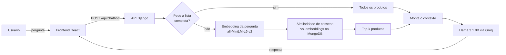

# 🍦 RAG Sorveteria

> **📚 Projeto de estudo/treino.** Criei este repositório para aprender, na prática e de ponta a ponta, como funciona uma aplicação de **RAG (Retrieval-Augmented Generation)**. A "sorveteria" é um cenário fictício e simples, pensado para testar o fluxo completo: embeddings, busca semântica, montagem de contexto e geração de resposta com LLM. Não é um produto em produção.


-F55036)


## Sobre o projeto

Um chatbot de atendimento para uma sorveteria fictícia. O usuário pergunta em linguagem natural, por exemplo *"tem algum sorvete bem cremoso?"*, e o assistente responde **apenas com base no cardápio cadastrado**, sem inventar produtos.

A ideia foi entender cada peça de um RAG sem esconder nada atrás de frameworks prontos: a geração de embeddings, a busca por similaridade e o prompt foram implementados manualmente.

## Como funciona



1. **Ingestão**: cada produto (nome + descrição) é salvo no MongoDB junto com o embedding da descrição, gerado localmente com o modelo `all-MiniLM-L6-v2` (Sentence Transformers).
2. **Roteamento simples**: se a pergunta pede uma listagem ("quais são", "me liste", "todos"...), o cardápio inteiro vai como contexto.
3. **Busca semântica**: caso contrário, a pergunta vira um embedding e é comparada com os produtos por similaridade de cosseno, retornando os mais relevantes (top-k). Se nenhum produto atinge o score mínimo (0.35), o cardápio inteiro é usado como fallback.
4. **Geração**: os produtos recuperados formam o contexto de um prompt que instrui o modelo a responder só com base nele. A resposta é gerada pelo **Llama 3.1 8B** via API da **Groq**, com temperatura baixa (0.2) para reduzir alucinações.

## Stack

| Camada | Tecnologias |
| --- | --- |
| Backend | Python 3.11, Django 5.2, Django REST Framework |
| RAG | Sentence Transformers (`all-MiniLM-L6-v2`), scikit-learn, NumPy |
| Banco | MongoDB (produtos + embeddings) |
| LLM | Llama 3.1 8B Instant via Groq API |
| Frontend | React, TypeScript, Vite, Tailwind CSS, shadcn/ui |
| Infra | Docker e Docker Compose |

## Estrutura

```text
rag-sorveteria/
├── backend/
│   ├── rag/
│   │   ├── embeddings.py       # geração de embeddings (Sentence Transformers)
│   │   ├── busca.py            # roteamento + busca semântica por similaridade de cosseno
│   │   ├── llm.py              # prompt e chamada ao Llama 3.1 via Groq
│   │   ├── chat.py             # orquestra o fluxo: busca → contexto → resposta
│   │   ├── mongo.py            # conexão com o MongoDB
│   │   ├── seed_mongo.py       # popula o banco com produtos de exemplo + embeddings
│   │   ├── seed_embeddings.py  # (re)gera embeddings dos produtos já cadastrados
│   │   ├── views.py / urls.py  # endpoint da API
│   │   └── test_*.py           # scripts para testar a busca e o chat pelo terminal
│   ├── rag_sorveteria/         # configurações do projeto Django
│   ├── requirements.txt
│   └── Dockerfile
├── frontend/
│   ├── src/
│   │   ├── components/chat/    # componentes da interface de chat
│   │   ├── lib/api.ts          # cliente da API
│   │   └── pages/
│   └── Dockerfile
└── docker-compose.yml
```

## Como rodar

### Pré-requisitos

- Python 3.10+ e Node.js 18+
- MongoDB rodando localmente (padrão: `mongodb://localhost:27017`)
- Uma chave de API da [Groq](https://console.groq.com/keys)

### 1. Backend

```bash
cd backend
python -m venv .venv
source .venv/bin/activate        # Windows: .venv\Scripts\activate
pip install -r requirements.txt
```

Crie o arquivo `backend/.env`:

```env
GROQ_API_KEY=sua_chave_da_groq
MONGO_URI=mongodb://localhost:27017
```

Popule o banco com o cardápio de exemplo (7 produtos fictícios):

```bash
cd rag
MONGO_URI="mongodb://localhost:27017" python seed_mongo.py
cd ..
```

> No Windows (PowerShell), defina a variável antes de rodar o script: `$env:MONGO_URI="mongodb://localhost:27017"`.
>
> Na primeira vez que o modelo de embeddings é usado, ele é baixado automaticamente do Hugging Face.

Suba a API:

```bash
python manage.py migrate
python manage.py runserver
```

A API fica disponível em `http://127.0.0.1:8000`.

### 2. Frontend

```bash
cd frontend
npm install
npm run dev
```

Acesse `http://localhost:8080`.

### Com Docker

O `docker-compose.yml` sobe o backend e o frontend. O MongoDB não está no compose: ele roda na sua máquina e o container acessa via `host.docker.internal`. Depois de rodar o seed (passo 1), ajuste o `backend/.env`:

```env
MONGO_URI=mongodb://host.docker.internal:27017
```

E suba tudo:

```bash
docker compose up --build
```

Frontend em `http://localhost:8080` e API em `http://localhost:8000`.

## API

### `POST /api/chatbot/`

**Requisição**

```json
{ "message": "Tem algum sorvete bem cremoso?" }
```

**Resposta (exemplo)**

```json
{
  "response": "Temos o Sorvete de Chocolate, feito com chocolate belga e pedaços de brownie, e o Sorvete de Pistache, também bem cremoso.",
  "produtos_relacionados": []
}
```

> O campo `produtos_relacionados` está reservado para uma evolução futura e hoje sempre vem vazio.

## O que aprendi

- Como embeddings representam significado: "sorvete cremoso" encontra produtos com descrições parecidas, mesmo sem as mesmas palavras.
- A importância do prompt para manter o modelo preso ao contexto, incluindo uma saída para quando a informação não existe.
- Que a busca semântica sozinha não resolve tudo: perguntas de listagem precisam de outro tratamento, daí o roteamento por palavras-chave e o fallback por score mínimo.
- Como integrar de ponta a ponta um front em React/TypeScript, uma API em Django e serviços de IA, tudo containerizado com Docker.

## Limitações e próximos passos

Por ser um projeto de estudo, algumas escolhas priorizaram a simplicidade:

- A similaridade é calculada em Python, comparando a pergunta com todos os produtos. Funciona para um cardápio pequeno, mas não escala. O próximo passo seria usar um índice vetorial, como MongoDB Atlas Vector Search ou pgvector.
- O roteamento de listagem usa palavras-chave fixas e poderia virar uma classificação de intenção feita pelo próprio LLM.
- O chat não guarda histórico: cada pergunta é respondida de forma independente.
- Hoje existem apenas scripts de teste manual; faltam testes automatizados.

## Autor

**Nicholas Santos Ychihara**
[LinkedIn](https://www.linkedin.com/in/nicholas-ychihara) · [GitHub](https://github.com/nsychihara)
